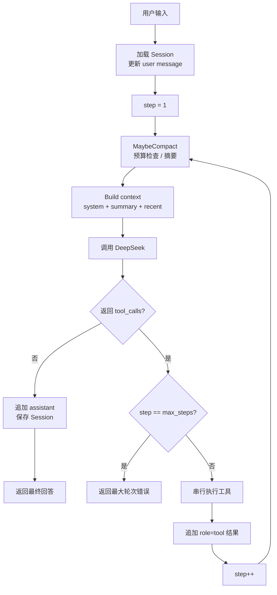
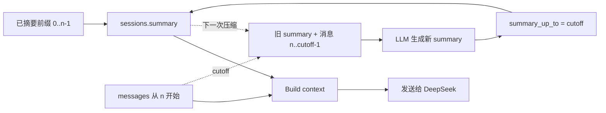

# Goblin

> 从零实现的、最小可用但可验证的 CLI Agent。

Goblin 不依赖 LangGraph、OpenHands、OpenClaw、PI 等 Agent 框架。主循环、工具注册、上下文压缩、Session 持久化都在本仓库实现；模型使用 DeepSeek 的 OpenAI 兼容 Chat Completions API。

- 规格：[docs/spec.md](docs/spec.md)
- 文档索引与维护规则：[docs/README.md](docs/README.md)
- 术语：[GLOSSARY.md](GLOSSARY.md)
- 决策：[ADR 0001](docs/adr/0001-mysql-only-persistence.md)、[ADR 0002](docs/adr/0002-native-tool-calls.md)

## 能力

- 原生 `tool_calls`：工具名称、描述、JSON Schema 随请求发送，模型自主决策。
- CLI：Cobra 命令树（`chat` / `run` / `sessions`），保留交互式 REPL。
- 四个工具：`calculator`、`search`（mock）、`read_docs`、`todo`。
- Agent 主循环：工具执行、结果回填、错误回喂、最大轮次。
- Session：UUID、严格恢复、MySQL 持久化、两个窗口互相隔离。
- Memory：最近消息 + 会话摘要 + MySQL 中的待办。
- 上下文压缩：超预算用 LLM 摘要，失败则截断降级。
- trace：JSONL 记录 LLM 请求、工具调用、压缩和错误。
- 测试：默认单测不依赖 Docker；MySQL 与真实 DeepSeek 使用 `integration` tag。

## 架构

```text
cmd/goblin
  └─ internal/cli     Cobra 命令树
       ├─ internal/config   Viper + .env
       ├─ internal/db       MySQL 连接 + 幂等 schema
       ├─ internal/agent    Engine / parser / prompt
       │    ├─ internal/llm        DeepSeek adapter
       │    ├─ internal/memory       预算 / 摘要
       │    ├─ internal/tools      Registry + 四工具
       │    └─ internal/session    MySQL Store
       └─ internal/trace    JSONL
```

一次 Run：



`max_steps` 包含最后一次 LLM 请求；最后一步不再向模型暴露工具，要求它收尾。

## 快速开始

### 1. 前置条件

- Go 1.25+
- Docker Desktop
- DeepSeek API Key

当前机器上 Docker Desktop 的 CLI 可能不在 PATH；仓库提供了辅助脚本，不需要手动改 PATH。

### 2. 配置密钥

```powershell
Copy-Item .env.example .env
# 编辑 .env，把 DEEPSEEK_API_KEY= 后面填上 key
```

`.env` 已被 git 忽略；不要提交。也可以使用系统环境变量 `DEEPSEEK_API_KEY`。

### 3. 启动 MySQL

```powershell
.\scripts\dev.ps1 up
```

脚本会定位 Docker Desktop 的 `docker.exe`，启动 `mysql:8.4`，并等待 `127.0.0.1:3306`。

常用命令：

```powershell
.\scripts\dev.ps1 status
.\scripts\dev.ps1 down
.\scripts\dev.ps1 reset   # 删除数据卷，需输入 yes
```

### 4. 运行

```powershell
go run ./cmd/goblin chat
```

新建 Session 后会打印 UUID：

```text
Goblin | model=deepseek-chat | tools=calculator, search, read_docs, todo
Session: 7f2c3a5e-...
```

恢复已存在的 Session：

```powershell
go run ./cmd/goblin chat --session 7f2c3a5e-...
```

不存在的 UUID 会直接报错，不会静默新建。

### 5. 常用命令

```bash
goblin chat                         # 新建 Session
goblin chat --session <uuid>        # 严格恢复
goblin chat --new                   # 强制新建
goblin run --session <uuid> "问题"   # one-shot
goblin sessions                     # 列出会话
goblin help
```

交互内：

| 命令 | 作用 |
|---|---|
| `/new` | 新建并切换 |
| `/sessions` | 列出会话 |
| `/switch <uuid>` | 切换 |
| `/history [n]` | 最近 n 条消息 |
| `/compact` | 手动压缩 |
| `/trace` | 上次运行的工具调用 |
| `/quit` | 退出 |

## 配置

优先级：命令行 flag > 进程环境变量 > `.env` > `config.yaml` > 默认值。

示例见 [config.example.yaml](config.example.yaml)。

| 配置 | 默认 | 说明 |
|---|---|---|
| `llm.model` | `deepseek-chat` | DeepSeek 模型 |
| `llm.base_url` | `https://api.deepseek.com` | OpenAI 兼容地址 |
| `llm.timeout` | `90s` | HTTP 超时 |
| `llm.max_retries` | `2` | 429/5xx/网络重试 |
| `agent.max_steps` | `8` | 单次 Run 最大 LLM 请求数 |
| `agent.max_context_tokens` | `32000` | 上下文预算 |
| `agent.reserve_output_tokens` | `2048` | 为输出预留 |
| `agent.compact_ratio` | `0.75` | 触发压缩的比例 |
| `agent.keep_recent` | `12` | 压缩后保留的最近消息 |
| `agent.summary_max_tokens` | `800` | 摘要上限 |
| `mysql.dsn` | 本地 goblin 库 | MySQL 连接串 |
| `logging.dir` | `./data/logs` | 日志与 trace |

环境变量：`DEEPSEEK_API_KEY`、`GOBLIN_LLM_API_KEY`、`GOBLIN_LLM_BASE_URL`、`GOBLIN_LLM_MODEL`、`GOBLIN_MYSQL_DSN`、`GOBLIN_LOGGING_DIR`。

## 工具

### calculator

手写 tokenizer + 递归下降解析，不使用 eval。支持 `+ - * / % ^`、括号、小数、一元正负号。

### search（mock）

本地 mock 文档库，返回标题、摘要、链接，并标注 `"source":"mock"`。不联网。

### read_docs

只读 `docs/` 和根目录 `README.md`；拒绝绝对路径、`..`、目录外文件和符号链接逃逸。单文件上限 64KB，列出 `docs/*.md`。

### todo

写入 MySQL `todos` 表，按 Session 隔离。支持 `add/list/complete/remove`。

## Memory 的召回时机与放置方式

每次 LLM 调用前重新构建上下文，包括工具调用后的下一次 Step。

| 信息 | 放置位置 | 何时进入上下文 |
|---|---|---|
| System prompt | 第一条 system message | 每次调用 |
| Session summary | system message 末尾 | 每次调用，若存在 |
| 最近 messages | 原生 user/assistant/tool 消息 | 每次调用，从 `summary_up_to` 之后取 |
| 当前用户输入 | messages 末尾 | 当前 Run |
| 工具结果 | `role=tool` 消息 | 工具执行后立即回填 |
| 待办 | MySQL `todos` | 模型主动调用 `todo` 时 |
| reasoning_content | 不进入上下文 | 仅展示/trace |

压缩规则：

1. `Build` 估算 token 超过 `输入预算 * compact_ratio` 时触发；
2. 切点对齐到 user message，不拆散 assistant tool_calls 与 tool result；
3. 旧 summary + 被切掉的消息交给 LLM 生成新 summary；
4. summary 写入 MySQL `sessions.summary`，`summary_up_to` 记录覆盖到哪条消息；
5. 摘要失败则保留旧摘要并标注“更早内容已省略”，不阻断对话；
6. `reasoning_content` 不回传模型；单条工具结果超过 16KB 时截断发送，MySQL 保留完整内容。



`summary_up_to` 是消息下标/条数，不是 token 数，也不是消息 ID。

追问：

- 纯对话：最近 messages 在窗口内；
- 带工具：上一轮 tool call/result 仍可见，也可重新调用工具；
- 跨重启：从 MySQL 恢复 messages 与 summary；
- 跨 Session：不支持，待办也隔离。

## MySQL

- 本地默认账号：`goblin / 123456`；root 使用同一密码（仅开发环境）。
- `sessions`：id、title、summary、summary_up_to、时间戳
- `messages`：session_id、seq、role、content、reasoning、tool_calls JSON、tool_call_id
- `todos`：session_id、todo_id、text、done、created_at

Schema 在启动时由 [internal/db/schema.sql](internal/db/schema.sql) 幂等创建；不引入迁移框架。

完整性：

- `Save` 在一个事务内 upsert session、替换该 Session 的 messages；
- `todos` 外键指向 sessions，删除 Session 时级联；
- MySQL 连接失败会提示先运行 `scripts/dev.ps1 up`。

## Trace 与日志

- `data/logs/trace.jsonl`：`run.start`、`llm.request`、`llm.response`、`context.compact`、`tool.call`、`tool.result`、`run.end`、`error`
- `data/logs/goblin.log`：应用日志
- 参数/结果预览最多 2KB；不记录 Authorization、API key 或完整配置
- `--verbose` 在 CLI 打印工具调用摘要

## 测试

默认单测（不需要 Docker / 真实 API）：

```powershell
go test ./...
go test -race ./...
go vet ./...
```

MySQL + 真实 DeepSeek 集成测试：

```powershell
.\scripts\dev.ps1 up
$env:GOBLIN_TEST_MYSQL_DSN = "goblin:123456@tcp(127.0.0.1:3306)/goblin?parseTime=true&charset=utf8mb4&loc=Local"
go test -tags=integration ./... -timeout 240s
```

真实 API 测试会从 `.env` 读取 `DEEPSEEK_API_KEY`，缺少 key 时自动 skip。测试矩阵与最近一次验收记录见 [docs/testing.md](docs/testing.md)；AI 协作与问题解决记录见 [docs/ai-prompts.md](docs/ai-prompts.md)。

## 安全

- `.env`、`config.yaml`、`data/` 均在 `.gitignore` 中；
- 仓库不包含真实密钥；
- `read_docs` 只读白名单；
- trace 不记录请求头；
- 生产环境请替换 Docker Compose 中的开发账号与密码。

## 已知限制

- 单用户、CLI，无 Web UI；
- 不支持同一 Session 的跨进程并发写；
- `Save` 使用整段消息替换，超大历史下可优化为 append-only；
- `read_docs` 不做分页；超大文档发送前会被 16KB 截断；
- `search` 是 mock，不访问互联网；
- 不做流式输出与工具并行。
